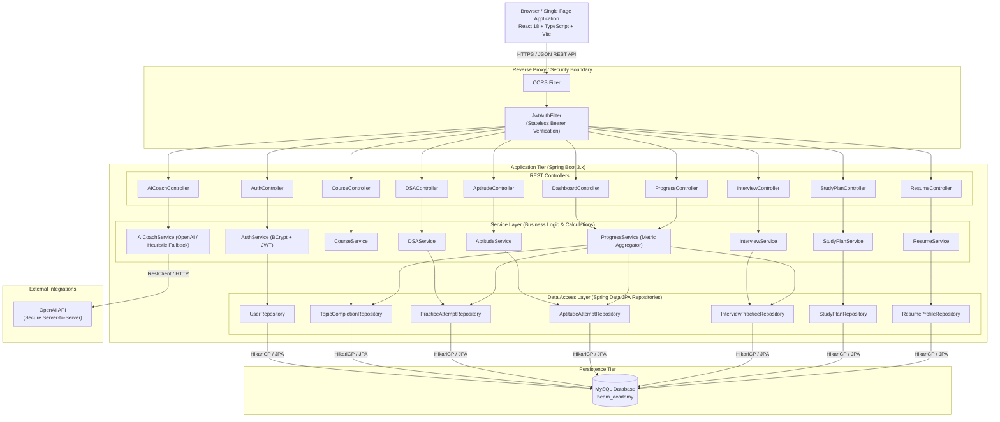

# 🏛️ Beam Academy — Technical Architecture Document

## 1. System Overview

**Beam Academy** is a modern, full-stack placement preparation platform engineered for aspiring Software Engineers and Java Backend Developers. It provides structured learning roadmaps, interactive coding pattern drills, aptitude assessments, technical interview coaching, and unified placement readiness tracking.

The system is designed with a **stateless 3-tier architecture**:
- **Client Tier**: React 18 SPA built with Vite, TypeScript, and modern modular CSS design system.
- **Application Tier**: Spring Boot 3.x RESTful API following strict Controller-Service-Repository patterns with Spring Security and JWT.
- **Data Tier**: Relational persistence managed via MySQL and Hibernate/Spring Data JPA, with connection pooling handled by HikariCP.
- **AI Gateway**: Isolated server-side OpenAI integration with built-in heuristic fallback, ensuring zero client-side credential exposure.

---

## 2. High-Level Architecture Diagram



---

## 3. Layered Design Pattern

The backend strictly adheres to clean architectural separation:

```text
HTTP Request
     │
     ▼
[ Controller Layer ]      <-- Endpoint mapping, DTO validation (@Valid), HTTP response codes
     │
     ▼
[ Service Layer ]         <-- Business logic, transactional boundaries (@Transactional),
     │                        progress calculations, AI prompt structuring
     ▼
[ Repository Layer ]      <-- Spring Data JPA interfaces, derived queries, custom JPQL
     │
     ▼
[ Entity / Database ]     <-- Relational mapping, foreign keys, schema constraints
```

### Key Separation of Concerns
1. **Controllers** contain zero business logic. They deserialize incoming JSON into validated Request DTOs, invoke services, and wrap results into ResponseEntity containers.
2. **Services** are where calculations live. For example, `ProgressService` queries completion records across multiple repositories to calculate real completion percentages, streak days, and interview readiness scores.
3. **DTOs (Data Transfer Objects)** decouple internal database entity structures from external API contracts. Sensitive attributes (like password hashes) are never exposed.
4. **Repositories** handle database queries through Spring Data JPA, ensuring parameterized queries and defense against SQL injection.

---

## 4. Security & Authentication Architecture

```text
Client Login Request: { email, password }
         │
         ▼
[ AuthController / AuthService ]
         ├── 1. Look up user by email in UserRepository
         ├── 2. Verify password using BCryptPasswordEncoder
         ├── 3. If valid, generate HMAC-SHA256 JWT Token with claims (userId, email)
         └── 4. Return token & user profile in AuthResponse
         
Subsequent Protected Requests: Authorization: Bearer <token>
         │
         ▼
[ JwtAuthenticationFilter ]
         ├── 1. Extract Bearer token from Authorization header
         ├── 2. Parse and validate signature & expiration using JwtService
         ├── 3. Resolve user details from database
         ├── 4. Populate SecurityContextHolder with UsernamePasswordAuthenticationToken
         └── 5. Permit request to proceed to downstream controller
```

### Security Measures:
- **Stateless Sessions**: No HTTP sessions are stored on the server (`SessionCreationPolicy.STATELESS`), allowing the backend to scale horizontally without session replication.
- **Password Protection**: Passwords are encrypted using salted BCrypt before persistence.
- **CORS Protection**: Controlled CORS configuration permits trusted frontend origins (`http://localhost:5173`, `http://localhost:3000`) and restricts exposed headers.
- **Key Isolation**: OpenAI API keys and JWT signing secrets are read via environment variables (`OPENAI_API_KEY`, `JWT_SECRET`) and are never returned in client payloads.

---

## 5. Database Schema & Entity Relationships

The relational model tracks student activity across every placement preparation discipline:

```text
┌──────────────────────┐
│        users         │
├──────────────────────┤
│ id (PK, BIGINT)      │◀──────┐
│ email (VARCHAR, UNQ) │       │
│ name (VARCHAR)       │       │ 1:N
│ password (VARCHAR)   │       ├──────────────────────────────┬──────────────────────────────┐
│ created_at           │       │                              │                              │
└──────────────────────┘       ▼                              ▼                              ▼
                 ┌──────────────────────────┐   ┌──────────────────────────┐   ┌──────────────────────────┐
                 │    topic_completions     │   │    practice_attempts     │   │    aptitude_attempts     │
                 ├──────────────────────────┤   ├──────────────────────────┤   ├──────────────────────────┤
                 │ id (PK, BIGINT)          │   │ id (PK, BIGINT)          │   │ id (PK, BIGINT)          │
                 │ user_id (FK)             │   │ user_id (FK)             │   │ user_id (FK)             │
                 │ course (java/sql)        │   │ pattern_id (VARCHAR)     │   │ category (VARCHAR)       │
                 │ topic_id (VARCHAR)       │   │ problem_title (VARCHAR)  │   │ total_questions (INT)    │
                 │ completed (BOOLEAN)      │   │ status (VARCHAR)         │   │ score (INT)              │
                 │ completed_at             │   │ hints_used (INT)         │   │ time_spent_seconds (INT) │
                 └──────────────────────────┘   │ notes (TEXT)             │   │ attempted_at             │
                                                │ attempted_at             │   └──────────────────────────┘
                                                └──────────────────────────┘
                                                              │
                                       ┌──────────────────────┼──────────────────────┐
                                       │ 1:N                  │ 1:1                  │ 1:1
                                       ▼                      ▼                      ▼
                        ┌──────────────────────────┐   ┌──────────────┐   ┌──────────────────────┐
                        │   interview_practices    │   │ study_plans  │   │   resume_profiles    │
                        ├──────────────────────────┤   ├──────────────┤   ├──────────────────────┤
                        │ id (PK, BIGINT)          │   │ id (PK)      │   │ id (PK)              │
                        │ user_id (FK)             │   │ user_id (FK) │   │ user_id (FK)         │
                        │ category (VARCHAR)       │   │ target_weeks │   │ target_role          │
                        │ question_title (VARCHAR) │   │ current_day  │   │ skills (TEXT)        │
                        │ status (CONFIDENT/etc)   │   │ focus_area   │   │ summary (TEXT)       │
                        │ user_notes (TEXT)        │   │ updated_at   │   │ updated_at           │
                        │ practiced_at             │   └──────────────┘   └──────────────────────┘
                        └──────────────────────────┘
```

---

## 6. Real Progress & Readiness Engine

Instead of static placeholders, Beam Academy computes metrics directly from database records:

$$\text{Java Progress} = \min\left(100, \frac{\text{Completed Java Topics}}{11} \times 100\right)$$

$$\text{SQL Progress} = \min\left(100, \frac{\text{Completed SQL Topics}}{16} \times 100\right)$$

$$\text{DSA Progress} = \min\left(100, \frac{\text{Completed DSA Attempts}}{12} \times 100\right)$$

$$\text{Aptitude Accuracy} = \frac{\sum \text{Correct Answers}}{\sum \text{Total Questions}} \times 100$$

$$\text{Readiness Index} = (0.35 \times \text{DSA}) + (0.25 \times \text{Java}) + (0.20 \times \text{SQL}) + (0.20 \times \text{Aptitude})$$

Streak days are calculated dynamically by grouping distinct calendar dates of user activity (`topic_completions`, `practice_attempts`, `aptitude_attempts`, `interview_practices`).

---

## 7. AI Placement Coach & Fallback Engine

The AI integration bridges candidate preparation with high-yield interview guidance:
1. **Zero Client Leakage**: The browser never sees third-party API credentials; it interacts solely with `POST /api/ai/coach`.
2. **Context-Aware Prompting**: The backend enhances queries with targeted placement engineering instructions (asking for time/space complexity, edge cases, and architectural trade-offs).
3. **Graceful Fallback**: If `OPENAI_API_KEY` is not provided or rate limits are reached, the system activates a deterministic fallback engine that synthesizes expert responses for core Java, Spring Boot, DSA, and SQL queries. The application **never crashes or returns 500 errors** when external services are unreachable.

---

## 8. Exception Handling & Response Structure

All exceptions are routed through `GlobalExceptionHandler` (`@RestControllerAdvice`), standardizing error formats across the entire API:

```json
{
  "timestamp": "2026-10-08T21:40:00Z",
  "status": 400,
  "error": "Bad Request",
  "message": "Validation failed for field 'email': must be a well-formed email address",
  "path": "/api/auth/signup"
}
```

Standardized HTTP status codes:
- `200 OK`: Successful read or update operation.
- `201 CREATED`: New resource created (User signup, attempt recorded).
- `400 BAD REQUEST`: Invalid payload or missing required fields.
- `401 UNAUTHORIZED`: Missing, expired, or invalid JWT token.
- `404 NOT FOUND`: Resource not found.
- `409 CONFLICT`: Unique constraint violation (e.g., email already registered).
- `500 INTERNAL SERVER ERROR`: Unhandled server exception with sanitized message.

---

## 9. Technology Stack Matrix

| Layer | Technology | Version | Purpose |
| :--- | :--- | :--- | :--- |
| **Frontend Framework** | React | 18.x | Modular UI component rendering |
| **Frontend Tooling** | Vite + TypeScript | 5.x / 5.x | Instant HMR, static type verification, fast builds |
| **Icons & Design** | Lucide React | 0.4x | Accessible, modern SVG iconography |
| **Backend Framework** | Spring Boot | 3.x / 4.x | Enterprise RESTful web services |
| **Security** | Spring Security + JJWT | 0.12.x | Stateless JWT authentication & password hashing |
| **Persistence** | Spring Data JPA / Hibernate | 6.x | ORM & database interactions |
| **Database** | MySQL | 8.0+ | Relational data persistence & indexing |
| **Connection Pool** | HikariCP | Built-in | High-performance JDBC connection pooling |
| **Monitoring** | Spring Boot Actuator | Built-in | Operational health checks (`/actuator/health`) |
| **AI Gateway** | Spring RestClient | Built-in | Secure server-side HTTP proxy to LLM providers |
